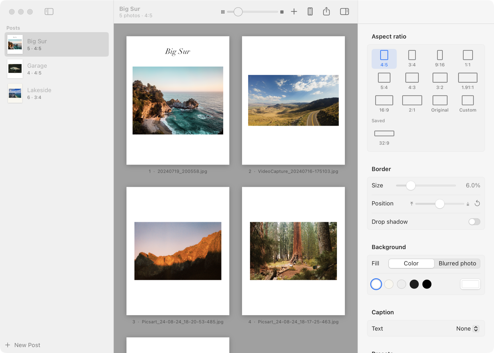
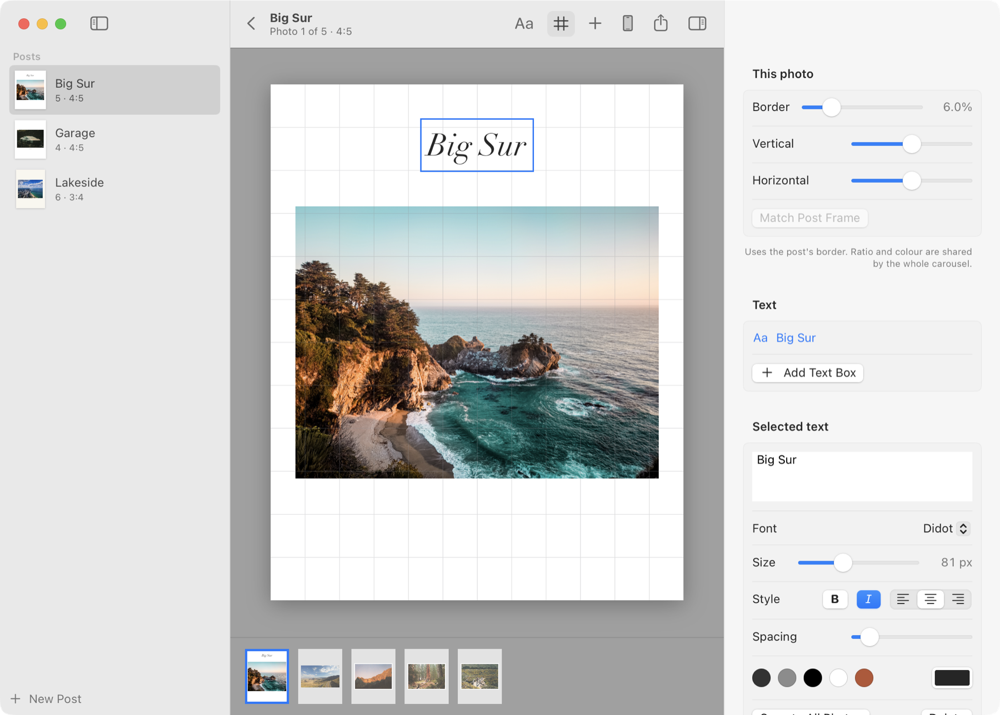
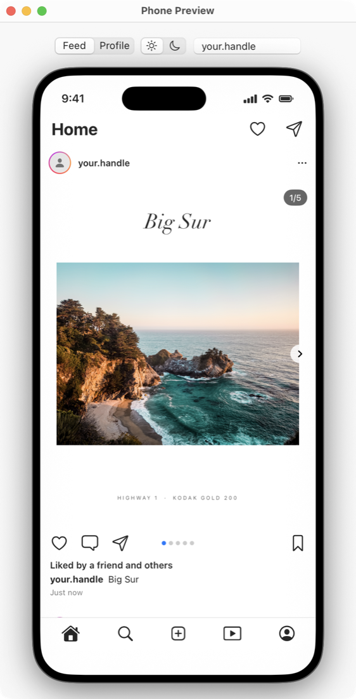
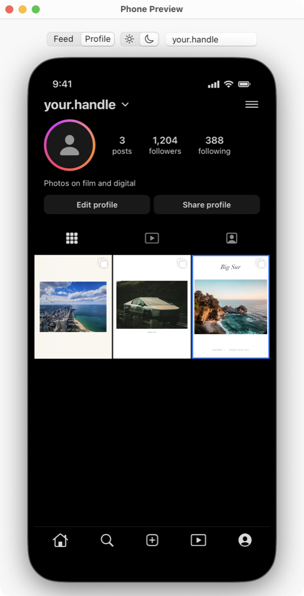
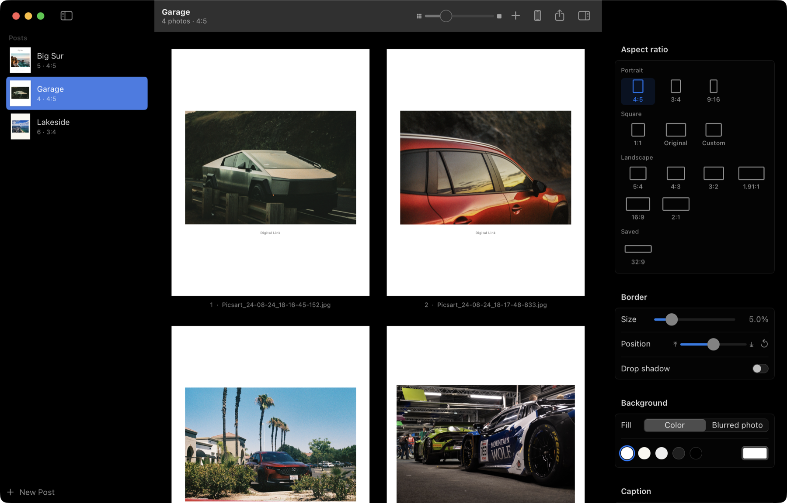

<div align="center">


# Autopost

**White borders for Instagram, done properly, on your Mac.**

Drop in your edits, pick a ratio, and get a whole carousel of padded, sRGB, 1080 px JPEGs in one click.

[](https://github.com/HNagouda/autopost/actions/workflows/ci.yml)
[](LICENSE)




</div>

## Why this exists

Lightroom on the Mac can't export a photo with a white border. Lightroom mobile can, so posting used to mean editing on the Mac, sending the photos to the phone, opening each one in Lightroom mobile and exporting again. Autopost replaces that round trip.

You group photos into posts, the way you'd plan a carousel. Each post has one frame, because Instagram crops every slide to the first slide's ratio anyway. Right-click a post, choose "Export Post As → 4:5", and every photo gets its border and lands in a folder ready to post, or goes straight to your phone over AirDrop.

## What it does

- **Frames that fit Instagram.** 4:5, 3:4, 1:1, 9:16, 1.91:1 and more landscape ratios (5:4, 4:3, 3:2, 16:9, 2:1). The photo is never cropped, only padded. Save your own ratio, like 32:9, and it sits next to the built-in ones.
- **Any border.** Border width, position, white, paper, black or any colour, a blurred copy of the photo as the background, and an optional drop shadow.
- **A per-photo editor.** Double-click a photo to give it its own border and position, and to place text anywhere on it.
- **Text you can place properly.** Any installed font, size, bold, italic, alignment and letter spacing. Boxes snap to a 12-column grid and to the photo's edges; hold Shift to place one freely. A new box lands where you put the last one, so repeated text lines up across the whole carousel.
- **A phone preview.** Swipe through the carousel in a feed and see how the post crops on your profile grid, in light and dark mode. Connect your Instagram account to see it next to your real posts.
- **Exports Instagram won't mangle.** sRGB JPEGs at 1080 px by default (Instagram stores feed photos at that width), with light output sharpening, and camera metadata kept or stripped. Location is removed by default.
- **Hard to lose work.** Deleted posts wait in Recently Deleted for 30 days, and the library is backed up at least every 10 minutes.
- **Light, dark and AMOLED black,** for the app and the phone preview.

<table>
  <tr>
    <td width="62%"></td>
    <td></td>
    <td></td>
  </tr>
  <tr>
    <td align="center">The editor, with the snapping grid on</td>
    <td align="center">Feed</td>
    <td align="center">Profile grid, dark</td>
  </tr>
</table>

<p align="center"><br>AMOLED black, for checking white frames the way an OLED phone shows them</p>

## Try it

**Download.** Grab `Autopost-<version>.zip` from [Releases](https://github.com/HNagouda/autopost/releases), unzip it and drag Autopost into Applications. The app is signed ad hoc rather than with a paid Apple developer certificate, so the first time you open it, right-click it and choose Open.

**Or build it.** You only need the Xcode Command Line Tools (`xcode-select --install`), not Xcode itself.

```sh
git clone https://github.com/HNagouda/autopost.git
cd autopost
./scripts/build-app.sh      # writes build/Autopost.app
open build/Autopost.app
```

## Using it

1. Drop folders onto the sidebar. Each folder becomes a post named after it, and loose files become one new post.
2. Pick a ratio and border in the inspector. 4:5 (1080 × 1350) is the safe feed default, and 3:4 (1080 × 1440) matches the profile grid tile. Ratios outside 4:5 to 1.91:1 get a warning, because Instagram crops feed posts to that range.
3. Double-click a photo to open the editor. Give that photo its own border and position, or add text with ⌘T. ⌘C and ⌘V copy a text box between photos, and "Copy to All Photos" puts it on every slide.
4. Open the phone preview (⌥⌘P) to swipe through the carousel and check the profile grid crop.
5. Export with ⌘E, or right-click a post and pick "Export Post As" to switch the ratio and export in one go. "Export and AirDrop" sends the files straight to your phone.

Exports go to `~/Pictures/Autopost Exports/<post name>/` as `<post-name>-01.jpg` and onwards. Re-exporting a post replaces its numbered files, so a post that shrank does not leave old slides behind.

#! NOTE[raw] : RAW files are decoded with Apple's default processing, not your Lightroom edits

Export an edited JPEG or TIFF from Lightroom first and import that.

Your posts live in `~/Library/Application Support/Autopost/library.json`. A deleted post moves to Recently Deleted at the bottom of the sidebar. On top of that, Autopost copies the library into `Backups/` next to it at least every 10 minutes while you work, and before every delete or restore, keeping the newest 50. File → Restore from Backup lists them.

## Connecting Instagram

The phone preview can show your real profile, so you see planned posts sitting on top of what is already on your grid. This is optional. Without it, the preview uses the handle you type and placeholder counts.

It uses Instagram's [API with Instagram Login](https://developers.facebook.com/docs/instagram-platform/instagram-api-with-instagram-login), which only works for Business and Creator accounts. The older Basic Display API for personal accounts was shut down in December 2024. Switching to a Creator account is free in the Instagram app.

1. Switch your Instagram account to a Business or Creator account, if it is not one already.
2. Create an app at [developers.facebook.com](https://developers.facebook.com/apps) and add the Instagram product.
3. Under App roles, add your account as an Instagram tester, then accept the invite in Instagram.
4. In the app dashboard, open Instagram > API setup with Instagram business login and click Generate token next to your account.
5. Paste the token in Autopost under Settings (⌘,) > Instagram and click Connect.

The token stays on your Mac, in your own login Keychain, and is never written to `library.json`. It is only ever sent to `graph.instagram.com`. Dashboard tokens last 60 days, and Autopost asks Instagram for a fresh one each time it loads your profile, so it keeps working as long as you open the app now and then. Instagram only refreshes tokens that are at least a day old, so the first refresh after you paste a new token fails quietly and the token you pasted stays in use.

## How the preview stays honest

`FrameLayout` decides where the photo and caption sit on the canvas. The grid, the editor, the phone preview and the exporter all call it with the same settings, so what you see in the app is what gets written. Sizes like the border, shadow and caption are fractions of the canvas width, which is why a frame looks the same at 1080 px and at full resolution.

Text boxes follow the same rule through `TextBoxRenderer`, and the preview draws them with the exporter's own Core Text code. Text is laid out on a fixed 1000-unit canvas and then scaled. Fonts like SF change shape between sizes, so laying text out at the real size would make the export wider or narrower than the preview.

## Layout

```
Package.swift                  SwiftPM package, one library and one app target
Sources/AutopostCore/          everything that can run without a window
  AspectRatio.swift            built-in ratios, saved ratios, and the ratios the Instagram feed allows
  FrameSettings.swift          border, background and caption settings, plus per-photo adjustments
  FrameLayout.swift            photo and caption rects on the canvas
  TextBox.swift                text boxes and the Core Text code that lays them out and draws them
  TextSnapping.swift           the grid and guide lines a dragged text box snaps to
  ImageSource.swift            ImageIO decoding (JPEG, HEIC, TIFF, camera RAW) and EXIF
  FrameRenderer.swift          draws the framed image in sRGB with Core Graphics
  PostExporter.swift           numbered JPEGs per post, a few photos in parallel
  Library.swift                posts, photos, presets, export settings, Recently Deleted
  CodableDefaults.swift        lets a library saved by an older version still load
  InstagramAPI.swift           profile, recent posts and token refresh from graph.instagram.com
Sources/Autopost/              the SwiftUI app
  AppIdentity.swift            the bundle identifier that names Keychain items and pasteboard data
  LibraryStore.swift           the library, saved to Application Support/Autopost/library.json
  LibraryBackups.swift         timestamped copies of library.json in the Backups folder next to it
  ThumbnailStore.swift         preview images, decoded once off the main thread
  ExportController.swift       runs exports, then reveals them in Finder or sends them with AirDrop
  PostGridView.swift           the photos of a post, framed, drag to reorder
  InspectorView.swift          frame settings for the selected post
  PhotoEditorView.swift        one photo, large, with its text boxes and a filmstrip
  TextBoxOverlay.swift         selecting, dragging and snapping text boxes on the editor canvas
  PhotoInspector.swift         the open photo's own border and position, and text box styling
  PhonePreviewView.swift       phone mockup window, feed and profile grid, light and dark
  InstagramAccount.swift       the optional Instagram connection, token kept in the Keychain
Tests/AutopostCoreTests/       layout, text, snapping, library loading and Instagram response tests
scripts/build-app.sh           builds build/Autopost.app
scripts/test.sh                runs the tests
scripts/make-icon.sh           regenerates Resources/AppIcon.icns
```

## Contributing

Issues and pull requests are welcome. Run the tests before opening a PR:

```sh
./scripts/test.sh
```

To try a change without touching your own posts, point the app at a throwaway library:

```sh
AUTOPOST_LIBRARY_DIR=/tmp/autopost-dev build/Autopost.app/Contents/MacOS/Autopost
```

If you ship your own build, set your own bundle identifier, so your Keychain items and settings never mix with anyone else's build:

```sh
BUNDLE_ID=io.github.yourname.autopost ./scripts/build-app.sh
```

With only the Command Line Tools installed, the build pins the macOS 26.5 SDK, because the macOS 27 SDK turns `@State` into a macro whose plugin only ships with Xcode. With Xcode installed, its own SDK is used.

CI runs the tests and builds the app on every push to `main` and on every pull request. Pushing a tag like `v1.1` builds the app and attaches `Autopost-v1.1.zip` to a GitHub release.

## License

Autopost is free software under the [GNU General Public License v3.0](LICENSE). You can use, study, change and share it, and anything you distribute that is built from it must be shared under the same license.
