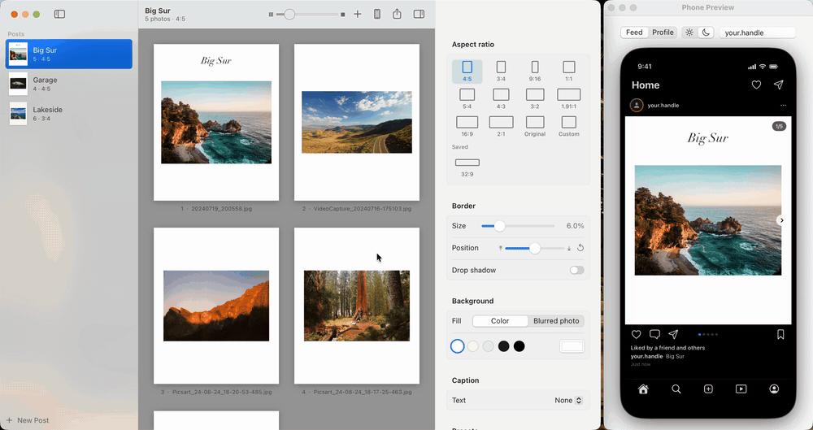

# Autopost

**White borders for Instagram, done properly, on your Mac.**

Drop in your edits, pick a ratio, and get a whole carousel ready to post in one click.

## Why this exists

Autopost was born out of necessity. I edit in Lightroom on the Mac, and Lightroom on the Mac can't export a photo with a white border. Lightroom mobile can, so every post meant editing on the Mac, opening everything again in Lightroom mobile, and exporting each photo from there with a border. I refused to install Lightroom Classic next to Lightroom just to get borders, and Photoshop would have meant framing every photo one by one. So I built the thing I wanted instead.

You group photos into posts, the way you'd plan a carousel, and pick one shape for the whole post (4:5, 3:4, square and so on). Your photo is never cropped, only padded with a border. Then you export the whole post at once, or send it straight to your phone with AirDrop.

In full transparency, Autopost is vibe coded. I described what I wanted and [Claude Code](https://claude.com/claude-code) wrote most of the code, while I tested every feature on my own photos and steered it. It's open source, so every line is there to read.

## What it does

- **Every Instagram shape, and your own.** 4:5, 3:4, 1:1, 9:16, 1.91:1, plus wider ones like 3:2 and 16:9. Need something unusual like 32:9? Save it and it sits next to the others.
- **Borders your way.** Any width, white, warm paper, black or any colour you like, or a soft blurred copy of the photo behind it.
- **Text anywhere.** Double-click a photo to add a title, a film stock or a location in any font on your Mac. Text snaps neatly into place, and the next photo's text lands in the same spot, so a whole carousel lines up.
- **A phone preview.** Swipe through the post the way your followers will, in light and dark mode, and see how it crops on your profile grid.
- **Exports Instagram won't mangle.** JPEGs at the size and colour space Instagram expects, so it doesn't squash or shift your colours. Your location is removed from the files by default.
- **Hard to lose work.** Deleted posts wait in Recently Deleted for 30 days, and Autopost keeps backups of your posts as you go.
- **Light, dark and pure black themes.**

<table>
  <tr>
    <td width="62%"></td>
    <td></td>
    <td></td>
  </tr>
  <tr>
    <td align="center">Placing text on a photo</td>
    <td align="center">The post in a feed</td>
    <td align="center">Your profile grid, in dark mode</td>
  </tr>
</table>

## Installing it

1. Download **Autopost-v….zip** from the [latest release](https://github.com/HNagouda/autopost/releases/latest). It's under "Assets" at the bottom of that page.
2. Double-click the zip to unzip it, then drag **Autopost** into your Applications folder.
3. Open Autopost. The first time, macOS says it can't check the app, because it isn't registered with Apple yet. Click Done, then open **System Settings → Privacy & Security**, scroll down, and click **Open Anyway** next to the message about Autopost. You only need to do this once.

Autopost needs macOS 14 Sonoma or newer.

## Using it

1. **Make a post.** Drag a folder of photos onto the left sidebar. Each folder becomes a post, named after the folder.
2. **Pick a shape and border** on the right. 4:5 is the safe choice for the feed. 3:4 is a little taller and fills the profile grid tile exactly.
3. **Fine-tune single photos.** Double-click a photo to give it its own border or position, or to add text (⌘T).
4. **Check it on the phone preview** (the phone button at the top, or ⌥⌘P).
5. **Export.** Press ⌘E, or right-click the post and pick "Export Post As" to choose a shape and export in one go. "Export and AirDrop" sends the photos straight to your phone.

Your exported photos land in **Pictures → Autopost Exports**, in a folder per post, numbered in carousel order.

A tip for RAW files: Autopost can open them, but it won't see your Lightroom edits. Export your edited photos from Lightroom as JPEG or TIFF first, then drop those into Autopost.

## Seeing your real Instagram profile (optional)

The phone preview can show your actual profile, so you can see a new post sitting on top of your existing grid before you post it. This only works with Business or Creator accounts, because that's what Instagram allows apps to read. Switching to a Creator account is free in the Instagram app's settings.

Setting it up takes about ten minutes, because Instagram makes you create a (free) developer app to get a key. The steps are in the [Instagram connection guide](DEVELOPMENT.md#connecting-instagram). Your key stays on your Mac and is only ever sent to Instagram.

## Questions

**Is it really free?** Yes. No subscription, no account, no watermark.

**Does it upload my photos anywhere?** No. Everything happens on your Mac. The only thing that ever talks to the internet is the optional Instagram connection, which reads your profile and never posts anything.

**Found a bug, or have an idea?** [Open an issue](https://github.com/HNagouda/autopost/issues/new/choose) (you'll need a free GitHub account), or say hi in [Discussions](https://github.com/HNagouda/autopost/discussions).

## For developers

Autopost is a native SwiftUI app. [DEVELOPMENT.md](DEVELOPMENT.md) covers how it works, building it yourself, and how releases happen, and [CONTRIBUTING.md](CONTRIBUTING.md) covers pull requests.

## License

Free and open source under the [GNU General Public License v3.0](LICENSE).
